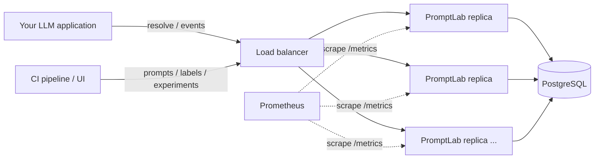
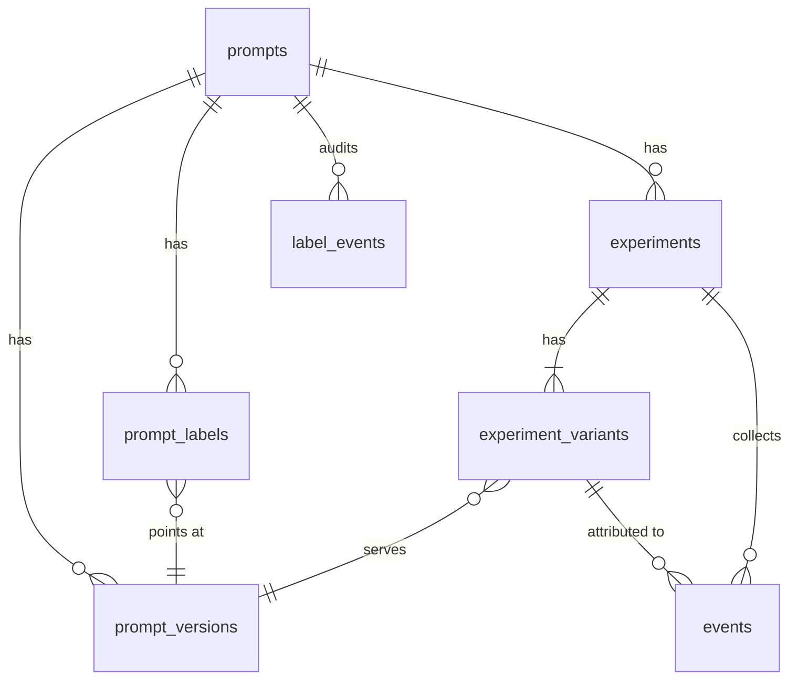

# Architecture

PromptLab is a stateless HTTP service in front of a relational database. Every replica is
identical: any request can be served by any instance, so the API tier scales horizontally
behind a load balancer and the database is the only stateful component.



## Module layout

| Layer | Location | Responsibility |
|-------|----------|----------------|
| HTTP | `src/promptlab/api/routes/` | Thin routers: auth dependency, request parsing, response models |
| Schemas | `src/promptlab/schemas/` | Pydantic v2 request/response models (unknown fields rejected) |
| Services | `src/promptlab/services/` | Business rules and transactions; no HTTP concerns |
| Persistence | `src/promptlab/models.py`, `db.py`, `migrations/` | SQLAlchemy 2 async ORM, Alembic migrations |
| Cross-cutting | `security.py`, `errors.py`, `observability.py`, `cache.py`, `config.py` | API keys and roles, error envelope, logs/metrics, TTL cache, settings |

## Request lifecycle

1. `RequestContextMiddleware` assigns or echoes `X-Request-ID`, times the request, records
   Prometheus metrics labelled by route template, writes a JSON access log line and converts
   unexpected exceptions into an `internal_error` envelope.
2. The route's role dependency (`require_runtime` / `require_editor` / `require_admin`)
   authenticates the API key (SHA-256 lookup, indexed) and checks the role hierarchy.
3. The service performs the work inside one database transaction and commits explicitly.
4. Domain errors (`ApiError` subclasses) become `{"error": {"code", "message", "details", "request_id"}}`.

## Data model



- **Versions are immutable** and numbered 1, 2, 3… per prompt; `UNIQUE(prompt_id, version)` plus a
  bounded retry makes concurrent publishing safe.
- **Labels** (`production`, `staging`, …) are movable pointers; every move is appended to
  `label_events`, which powers history and one-call rollback.
- **Experiments** pin each variant to a version. Assignment is computed, not stored.

## Deterministic assignment

```
enrolled = bucket(salt + ":traffic:" + subject) < traffic_percent * 100
variant  = cumulative_weights.find(bucket(salt + ":variant:" + subject))
bucket(x) = int(sha256(x)[:15], 16) mod 10000
```

Because assignment is a pure function of the experiment's salt, traffic and weights, every
replica returns the same variant for the same subject without a database write or a shared
cache. Separate hash inputs make the traffic gate independent of variant choice.

## Hot path: `POST /v1/prompts/{name}/resolve`

The running experiment (with its variants' templates) is loaded once and kept in a bounded,
per-replica TTL cache (`PROMPTLAB_RESOLVE_CACHE_TTL_SECONDS`, default 2 s). Assignment and
rendering then happen in memory; the only write is the optional exposure event. Lifecycle
changes invalidate the local entry, and other replicas converge within the TTL.

## Analytics

Results are computed with SQL aggregates (`COUNT(DISTINCT)`, `SUM`, `SUM(x²)`) grouped by
variant, so memory use is independent of event volume. Statistics are implemented in pure
Python (no SciPy):

| Metric kind | Per-variant estimate | Test vs control |
|-------------|----------------------|-----------------|
| `binary` | Conversion rate, Wilson interval | Pooled two-proportion z-test |
| `numeric` | Mean, standard deviation, t interval | Welch's t-test |
| all | — | Chi-square sample-ratio-mismatch check (flag at p < 0.001) |

## Scaling notes

- **API tier:** stateless; scale replicas with the HPA (`deploy/k8s`). Size the connection pool so
  `replicas × workers × (pool_size + max_overflow)` stays below PostgreSQL `max_connections`,
  or put PgBouncer in front of the database.
- **Reads:** prompt and experiment reads are indexed point lookups; resolve uses the TTL cache.
- **Writes:** event ingestion is batched (up to 1,000 events per request) and idempotent via
  client-supplied `event_id`s, so clients can retry safely.
- **Growth path:** the events table can be partitioned by time or moved to a read replica for
  analytics without changing the API.
